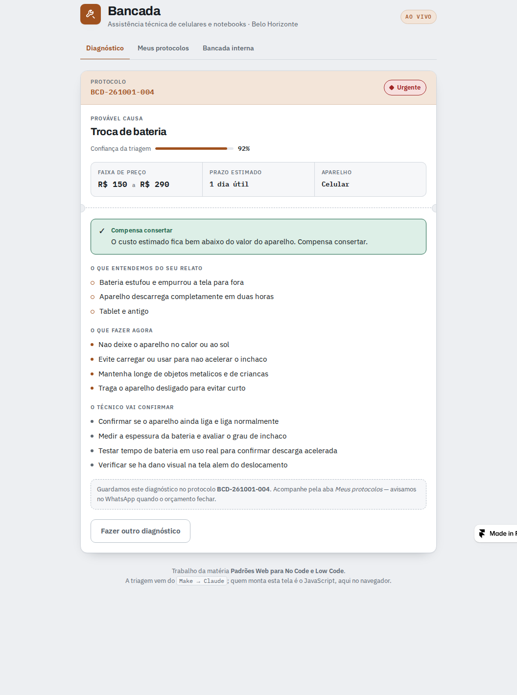
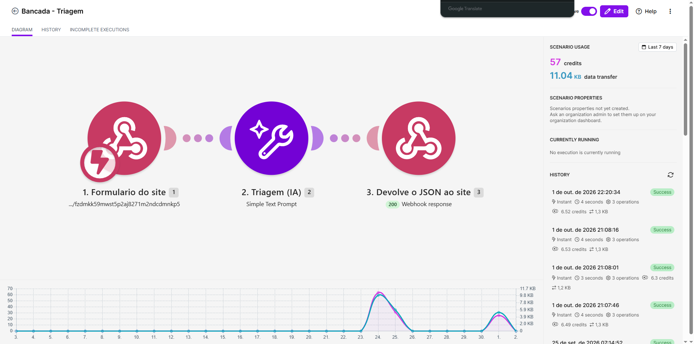
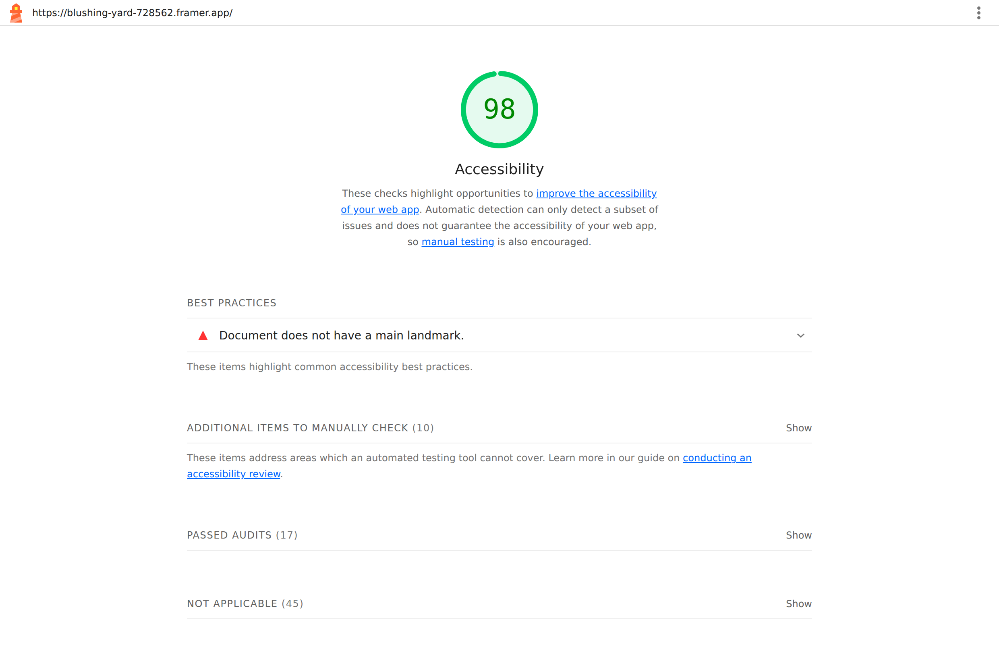

# Bancada

Triagem técnica inteligente para uma assistência de celulares e notebooks.
O cliente descreve o defeito com as próprias palavras — digitando ou falando —
e recebe um diagnóstico com provável causa, faixa de preço, prazo e o que fazer
antes de sair de casa. A mesma triagem alimenta a fila interna do técnico,
ordenada por urgência.

Trabalho da disciplina **Padrões Web para No Code e Low Code** —
Faculdade de Tecnologia Rocketseat / UniFECAF.

**Aplicação publicada:** https://blushing-yard-728562.framer.app
**Parte teórica (ABNT):** [`docs/parte-teorica-abnt.pdf`](docs/parte-teorica-abnt.pdf)

---

## O problema

Uma assistência técnica de bairro não tem equipe de desenvolvimento e vive de
atendimento no direct e no WhatsApp. O cliente pergunta "quanto custa trocar a
tela?" e a resposta honesta — *depende do modelo, do tipo de dano e do que o
técnico encontrar* — não cabe numa mensagem. A conversa morre ali.

**Público:** quem quebrou o aparelho e precisa decidir, ainda em casa, se vale a
pena consertar.

**Solução:** um diagnóstico em um minuto, sem cadastro, que responde a pergunta
real do cliente ("compensa?") e já entrega o caso classificado para a oficina.

## Funcionalidades

- Diagnóstico a partir de texto livre ou de voz
- Ficha com provável causa, confiança da leitura, hipótese alternativa, faixa de
  preço, prazo e veredito de "compensa consertar"
- Lista dos fatos que o sistema extraiu do relato, para o cliente conferir se foi
  entendido
- Cuidados imediatos e perguntas que o técnico vai confirmar, específicos do caso
- Protocolo e acompanhamento de status
- Painel interno com a fila ordenada por urgência, contadores e troca de status

## Tecnologias e ferramentas

| Camada | Escolha |
|---|---|
| Plataforma no-code | **Framer** (plano gratuito, publica em `.framer.app`) |
| Componente personalizado | HTML, CSS e JavaScript escritos à mão, sem biblioteca |
| Automação | **Make** — webhook, módulo de IA e resposta ao webhook (três módulos) |
| IA | **Claude Haiku** via AI by Make, como classificador |

O Webflow foi descartado na escolha: o *Code Embed* não funciona no plano
gratuito, o que inviabilizaria a exigência central do trabalho.

## Personalizações com padrões web

O que o Framer entrega pronto são as seções institucionais. Tudo abaixo é código
próprio, dentro de um Embed:

- **Web Speech API** para ditar o relato, com degradação silenciosa onde o
  navegador não suporta
- **Padrão ARIA de abas** (`tablist`/`tab`/`tabpanel`) com navegação por setas,
  Home e End, e `tabindex` rotativo
- **Validação própria** com resumo de erros focável, links para o campo com
  problema e `aria-invalid`
- **`aria-live`** anunciando o diagnóstico quando ele chega
- **Tokens CSS** para toda a paleta, em vez de cores soltas
- **`prefers-reduced-motion`** desligando as animações
- **`localStorage`** guardando os protocolos daquele visitante, sempre dentro de
  `try/catch` porque em aba anônima ele falha
- Layout em `flex`/`grid` com `gap`, sem rolagem horizontal a 390 px
- **`lang` e `title` definidos por script dentro do Embed**, porque o Framer
  monta o iframe sem nenhum dos dois — sem isso o leitor de tela lê o português
  com fonemas de inglês e anuncia "quadro sem nome"
- **`width:100%` + `min-width:0` no contêiner**, porque o Framer envolve o código
  num `body` com `display:flex`: sem isso o item se recusa a encolher abaixo do
  próprio conteúdo e a faixa de abas empurrava o componente para fora da tela a
  390 px

## O recurso inteligente

A IA **não escreve o texto que o cliente lê.** Ela recebe o relato e devolve
JSON: categoria (de uma lista fechada de sete), confiança, hipótese alternativa,
urgência, os fatos que extraiu do relato, as perguntas de checagem daquele caso e
um resumo para o técnico. Quem desenha a interface é o JavaScript.

Preço, prazo e o veredito de "compensa consertar" **não passam pela IA** — saem
do catálogo da loja, no próprio código. Isso elimina a possibilidade de o modelo
inventar um valor para o cliente.

O prompt está em [`make/prompt-triagem.txt`](make/prompt-triagem.txt) e o
contrato de saída em [`make/contrato-saida.json`](make/contrato-saida.json).

## Responsividade e acessibilidade

Medido no site publicado, em navegador automatizado:

| Teste | Resultado |
|---|---|
| **axe-core** (WCAG 2.1 A e AA) a 1200, 900 e 390 px, tema claro e escuro, em três estados da tela (formulário, ficha pronta, painel interno) | **0 violações** |
| **Lighthouse**, categoria Acessibilidade, na URL publicada | **98/100** |
| Rolagem horizontal, medida tanto na página quanto **dentro do iframe do Embed**, a 1200, 900, 390 e 360 px | nenhuma |
| Corte do componente nos três breakpoints | nenhum |
| Erros de console vindos do código da aplicação | nenhum |

O único item que o Lighthouse ainda aponta é `landmark-one-main`: a página não
tem um elemento `<main>`. Quem gera a marcação das seções é o Framer, e o plano
gratuito não dá acesso à tag HTML de cada frame — está documentado como
limitação da plataforma, não como descuido do projeto. O relatório está em
`docs/prints/06-lighthouse.png`.

A auditoria de design confirmou que a página do Framer e o componente usam
exatamente os mesmos valores: fundo `rgb(237,239,242)`, texto `rgb(22,27,33)`,
acento `rgb(160,81,30)`, Archivo nos títulos e IBM Plex Sans no corpo.

## As duas cópias do componente

| Arquivo | Para que serve |
|---|---|
| `bancada-diagnostico.html` | Fonte comentada. Abre sozinha no navegador e tem tema escuro por `prefers-color-scheme`. |
| `framer/embed-publicado.html` | Exatamente o que está colado nos três Embeds do Framer e no ar hoje. |

A cópia do Framer é a mesma aplicação com dois ajustes de contexto: os
comentários saem para encurtar o campo do Embed, e o bloco de tema escuro é
removido porque a página do Framer é só clara — um cartão escuro dentro de uma
página clara pareceria defeito.

## Prints

**A ficha de diagnóstico no site publicado:**



**O cenário no Make — três módulos e o histórico de execuções:**



**Lighthouse de acessibilidade na URL publicada:**



| Arquivo | O que mostra |
|---|---|
| [`01-site-desktop.png`](docs/prints/01-site-desktop.png) | Site publicado inteiro, desktop (1200 px) |
| [`02-site-celular.png`](docs/prints/02-site-celular.png) | Site publicado inteiro, celular (390 px) |
| [`03-diagnostico-desktop.png`](docs/prints/03-diagnostico-desktop.png) | Ficha de diagnóstico, desktop |
| [`04-diagnostico-celular.png`](docs/prints/04-diagnostico-celular.png) | Ficha de diagnóstico, celular |
| [`05-cenario-make.png`](docs/prints/05-cenario-make.png) | Cenário no Make e histórico de execuções |
| [`06-lighthouse.png`](docs/prints/06-lighthouse.png) | Lighthouse: 98 em acessibilidade ([relatório completo](docs/prints/lighthouse-relatorio.html)) |

As capturas 01 a 04 foram tiradas do site publicado em navegador automatizado; a
03 e a 04 mostram uma resposta real do Make registrada durante os testes.

## Como testar

1. Abra a aplicação publicada (link no topo) e clique em **Fazer o diagnóstico** —
   a página desce até o formulário.
2. Preencha nome e WhatsApp (pode ser fictício), escolha o aparelho e descreva um
   problema — ou use o botão **Usar um exemplo**.
3. Envie e veja a ficha. A resposta leva de 3 a 4 segundos.
4. Abra **Bancada interna** para ver o caso entrar na fila já classificado.

Para rodar o componente sozinho, sem o Make: abra `bancada-diagnostico.html` no
navegador. Com a constante `WEBHOOK` vazia, ele roda em modo demonstração com a
triagem simulada no próprio navegador, no mesmo formato que o Make devolve.

## Estrutura

```
bancada-diagnostico.html        componente completo, fonte comentada
framer/embed-publicado.html     o que está colado no Embed do Framer hoje
make/prompt-triagem.txt         prompt do classificador
make/contrato-saida.json        formato de saída aceito pelo site
make/blueprint-bancada.json     blueprint do cenário, pronto para importar
make/montagem-do-cenario.md     como montar o cenário no Make
docs/parte-teorica-abnt.pdf     parte teórica formatada em ABNT
docs/parte-teorica.txt          o mesmo texto, sem formatação
docs/roteiro-video.md           roteiro do vídeo pitch, cena a cena
docs/prints/                    capturas de tela e relatório do Lighthouse
```
